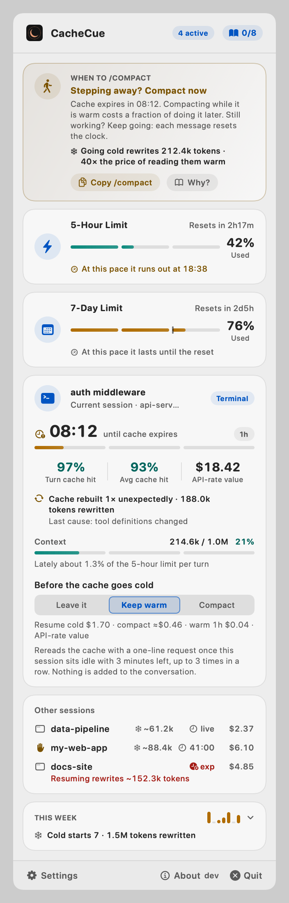
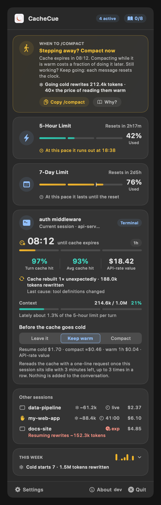

# CacheCue

**Know when to `/compact`.** A macOS menu bar app for [Claude Code](https://code.claude.com) that watches your prompt cache, your context size and your rate limits, and tells you whether now is a good moment to compact, and why.

**Official website:** [elvisli.ca/cachecue](https://elvisli.ca/cachecue) · **Download:** [CacheCue.dmg](https://github.com/elvisli999/CacheCue/releases/latest/download/CacheCue.dmg) (latest release, signed and notarized)

<p>
  
  
</p>

In the menu bar it is its crescent, two small gauges and a countdown:


- **5h / 7d**: how much of each rate-limit window is used
- **the clock**: time left before the current session's prompt cache expires (`live` while a turn is running, `exp` once it has expired)
- **the dot**: CacheCue has something for you to act on
- **the dot in the crescent**: some session is waiting for your permission or your reply (a switch in Settings turns it off)

CacheCue is not affiliated with Anthropic.

## Why the timing of `/compact` matters

Claude Code re-sends your whole conversation with every request. Prompt caching makes that cheap, as long as the cache is warm. That makes the moment you compact worth choosing:

- **While the cache is warm**, the request that writes the summary reads your history from the cache, so compacting costs a fraction of what the context size suggests.
- **After the cache has expired**, the same request reprocesses the full history uncached. That is the most expensive moment to compact, and your next message would have reprocessed it all anyway.
- **Compacting throws detail away**, so the middle of a task is the worst place for it, and on a small context it costs more than it saves.
- **`/clear` costs nothing.** For unrelated work it beats compacting.

Cache reads are billed at a tenth of the base input price or less, and one-hour cache writes at twice the base price, so letting a large context go cold costs at least 20 times what keeping it warm does: 40 times on Opus 5.5 and Sonnet 5.5, 80 times on Fable 5.1, whose cache reads cost less still. The cache lives for an hour on a Claude subscription, and five minutes on usage credits, an API key or a cloud provider.

Sources: [How Claude Code uses prompt caching](https://code.claude.com/docs/en/prompt-caching), [Manage costs effectively](https://code.claude.com/docs/en/costs), [Pricing](https://platform.claude.com/docs/en/about-claude/pricing).

## What CacheCue advises

For the session that last did something, the first rule that applies:

| Situation | Advice |
| --- | --- |
| A turn is running | Nothing: wait for it to end |
| Context window 80% full or more | Compact now, before auto-compact picks its own moment |
| Context under 50k tokens | No need: compacting would cost more than it saves |
| Cache expired | Decide before you continue: `/clear` if you are done with the history, otherwise `/compact` first |
| Cache expires within 10 minutes (within 90 seconds, on a five-minute cache) | Stepping away? Compact now. Still working? Keep going, each message resets the clock |
| Context of 100k tokens or more | Compact at the next stopping point, between tasks |
| Otherwise (50k to 100k) | Compact only when switching tasks |

The thresholds are rules of thumb, not figures from Anthropic. The advice card has a button that copies `/compact` for you to paste, and a **Why?** that opens the lesson behind the advice.

Under the advice is what going cold would cost this session: the tokens it would rewrite, as Claude Code itself counts them, and how many times dearer that is than reading them warm on the model in use. Where the dollars are a bill (no subscription), it gives those too, at API list prices.

## What else it tells you

- **Why the cache broke.** When Claude Code counts a cache miss, the session card says how many there were, how many tokens they wrote again, and what likely caused the last one: tool definitions changed, the system prompt changed, a five-minute cache ran out. Press it for the lesson on what quietly empties the cache. (Terminal sessions, Claude Code 2.1.260 or later.)
- **Five minutes or an hour.** The countdown is measured against the cache's real lifetime, shown beside it as `5m` or `1h`, so a five-minute cache is not forever "about to expire".
- **Which session to look at.** With several open, the one about to lose a cache worth keeping comes first, not the one you touched last. Each of the others shows what it would rewrite if it went cold. A switch in Settings goes back to always following the latest.
- **A notification before a cache goes cold**, if you turn it on: which project, how long is left, what it would rewrite, and buttons to **Keep warm** or **Compact** that session there and then (where its plugin can). Once per cache lifetime, never while a turn is running, never for a context too small to matter. There is a second switch for a limit reaching 80% and 95%, and for a window starting over. Both are off until you turn them on, which is also when macOS asks whether CacheCue may notify you.
- **Where your pace leads.** Under each limit: at this rate it runs out at 14:32, or it lasts until the reset. The 7-day bar carries a mark where even use would stand.
- **This week.** Cold starts and unexpected rebuilds, the tokens they wrote again, the average cache hit rate and the cost by project, from totals kept on your Mac.
- **Who is waiting.** A session where Claude Code is waiting for your permission or your reply is marked with a raised hand, and a dot shows in the menu bar's crescent for as long as any session is.
- **What picking a cold session back up costs.** A session whose cache has already expired says under its name how many tokens resuming it rewrites.
- **What a turn takes of your limit.** Once a session has done a few turns, its card says roughly what share of the 5-hour limit each has been taking lately. The bigger the context, the bigger the share. It is an estimate: what the limit grew by is credited to a session only while it was the one at work, and use on your other devices can slip in.
- **What compacting saved.** "This week" counts the compactions it saw, yours and Claude Code's own, and how many tokens they took off the context.

## Before a cache goes cold: keep it warm, compact it, or leave it

Advice is no use while you are at lunch. Each session card on a one-hour cache has a choice, **Before the cache goes cold**, with three options, and **Leave it** until you pick another for that session. Under it, one line puts a price on each, at API list prices: coming back to a cold cache, compacting first (an estimate, taking the summary to run to about 15k tokens), and keeping the cache warm for another hour.

- **Keep warm.** When the session has sat idle until about three minutes of cache are left, and has at least 50k tokens of context, CacheCue's plugin sends one tiny request that replays the conversation as Claude Code last sent it, so the cache is read once and lives another hour. Nothing is added to the conversation and nothing is lost. A read costs what reading the context from the cache costs (on Opus 5.5, a twentieth of the base input price), against twice the base price to write it all again later; on a subscription it counts against your limits like any request. It keeps warm at most three times in a row, about three hours, then lets the cache go. Only a read the cache actually served counts; if the cache had already gone, the card says keeping warm did not go through.
- **Compact.** When the session has sat idle until about five minutes of cache are left, with the same 50k minimum, the plugin runs `/compact` there. The summary is written while reading the history is still cheap, and what you come back to is a small context instead of a large cold one. Settings has a line of text sent with these compactions, saying what the summary should keep (by default file paths, decisions and the reasons for them, and unfinished work); empty it to use Claude Code's own summary. Your own `/compact` is not touched.

Know what you are choosing:

- **Compacting throws detail away and cannot be undone**, and keeping warm costs a little every hour it runs. That is why both are per session and never on by default.
- **Claude Code compacts idle terminal sessions itself** from version 2.1.299: a conversation of 200k tokens or more left idle for about 54 minutes is compacted before its one-hour cache runs out. On such a session the card says when that will happen and CacheCue stays out of it, rather than act twice; to choose for yourself instead, turn off *Idle compaction* in `/config` (or set `"idleCompaction": false`). Desktop app sessions are not affected.
- Both need the plugin (version 0.7 or later for keeping warm) loaded in that session, and the session's Claude Code still running. A session that was open before the plugin updated has to be closed and opened again (in the desktop app, `/reload-plugins` does not bring the new one in); the card says so. A Mac that is asleep does nothing.
- While a summary is being written, a minute or two on a large context, that session cannot take a message.
- Neither is offered on a five-minute cache, where any pause would trigger it.
- Each is asked for once per cache lifetime. Afterwards the card shows when it ran: for a compaction, the context before and after; for keeping warm, how many times in a row so far.
- **A spend limit instead of the two windows**, on an account behind a Claude apps gateway that sets one.

## A short course in spending fewer tokens

The book button in the popover opens an eight-lesson guide, each a few points and one takeaway, with a link to the documentation it is drawn from:

<p>
  
  
</p>

1. Why long sessions get expensive
2. Warm and cold: the cache has a clock
3. What `/compact` really costs
4. The best moment to compact
5. `/compact`, `/clear` or `/rewind`?
6. What quietly empties the cache
7. Keep the context small to begin with
8. Reading CacheCue at a glance

The lessons are written in all 20 languages the app speaks, and follow the language you choose.

## Install

Requires macOS 13 or later.

1. Download [CacheCue.dmg](https://github.com/elvisli999/CacheCue/releases/latest/download/CacheCue.dmg) (or pick a version from [Releases](https://github.com/elvisli999/CacheCue/releases)) and drag CacheCue to Applications. It is signed and notarized, and runs on Apple silicon and Intel.
2. Open it. It lives in the menu bar and has no Dock icon.
3. Click the menu bar item and press **Connect** on each card that fits how you use Claude Code:
   - **Terminal sessions are not connected** for Claude Code in a terminal.
   - **Claude desktop app is not connected** for the Claude desktop app.

Then send a message in Claude Code, and the session shows up in the menu bar. CacheCue shows only what Claude Code hands it, so until one of the two is connected the popover stays empty and says so. A card you have no use for can be put away with its ✕.

CacheCue draws nothing inside Claude Code itself: no status line in the terminal, no band in the desktop app. Everything it has to say is in the menu bar.

### What the two buttons do

**Terminal sessions.** Points Claude Code's `statusLine` setting at CacheCue's own command, which reads the figures Claude Code pipes to it, leaves them for the menu bar and prints nothing. It keeps every other setting, and saves a copy of the file first as `~/.claude/settings.json.cachecue-backup`.

If you already have a status line, you can **keep it**: CacheCue's command takes its figures, then hands the same input to your status line and passes on whatever that prints, so your terminal looks as it did. (Your command gets five seconds; after that CacheCue stops waiting for it.) Or you can replace it, in which case nothing shows in its place. From a terminal:

```bash
/Applications/CacheCue.app/Contents/MacOS/CacheCue setup-statusline            # no status line yet
/Applications/CacheCue.app/Contents/MacOS/CacheCue setup-statusline --keep     # keep yours running behind it
/Applications/CacheCue.app/Contents/MacOS/CacheCue setup-statusline --force    # replace yours
/Applications/CacheCue.app/Contents/MacOS/CacheCue setup-statusline --remove   # take CacheCue out, yours back
```

Restart your terminal sessions afterwards.

**Claude desktop app.** The desktop app does not run status line commands, so CacheCue carries a small Claude Code plugin for it. Connect copies the plugin to `~/Library/Application Support/CacheCue/marketplace/` and asks the Claude Code already on your Mac (the terminal one, or the copy the desktop app keeps for itself) to install it from there: no terminal, no download. New sessions in the desktop app then show up in the menu bar, and when CacheCue updates, its copy of the plugin updates with it. If you would rather install it yourself, from a terminal session:

```text
/plugin install cachecue --marketplace elvisli999/CacheCue
```

The plugin is built on Claude Code's function-hooks API, which is in early access and may change between releases without notice. In the desktop app it only sees a turn's totals when the turn ends, so there the hit rate is per turn, not per request. It is not told how long a cache write lives either: it takes an hour where the account has a 5-hour or 7-day window, five minutes otherwise, and the popover marks that as a guess (`~1h`). Nor does it get Claude Code's count of what a cold cache rewrites or of cache misses, so a desktop session's rewrite figure is its context size, marked `~`.

Once installed, the plugin also runs in terminal sessions, where it writes one note only: whether a turn is running, whether Claude Code is waiting for you, how many turns have finished, and the size of the context before and after its last compaction. The status line command is told none of these.

In the popover, a terminal connected with your own status line kept behind it shows a **Disconnect** button: it takes CacheCue's command out and leaves yours as it was.

## Getting help

**Support** on the About page (bottom of the popover) is the way in: write to the developer, attach a screenshot if it helps, and follow the conversation under **My Tickets**, all without leaving the app. When support answers, CacheCue plays a sound and an envelope pulses at the top of the popover; press it to go straight to the reply.

<p>
  
  
</p>

## What it reads, and what it does not

- **The network is used for two things, and never for your sessions.**
  - *Updates*, which you can turn off: once a day [Sparkle](https://sparkle-project.org) asks `elvisli.ca/cachecue/appcast.xml` (the author's site, which only redirects to this repository's latest release on GitHub) whether there is a newer version, and downloads it from GitHub when you choose to install it.
  - *Support tickets*, only once you have used the support page yourself: sending a ticket sends your email, what you wrote, an optional attachment and a random ID for this Mac (so "My Tickets" can find it again) to the developer's support server. After that, while one of your tickets is still open, the app asks that server every five minutes whether support has replied, sending only the random ID; it stops when your tickets are closed. If you never open the support page, none of this happens.

  The status line command and the plugin never touch the network.
- **No credentials.** It never reads your Claude login, Keychain items or cookies.
- **No transcripts.** It does not read your conversations. One thing to be exact about: to count compactions, the plugin listens to Claude Code's compaction event, and that event carries the conversation being compacted. The plugin hands it on untouched and keeps two numbers from the result, the token counts before and after. It does not read, store or send what was said.
- **It acts in a session only where you told it to.** By default CacheCue only watches. The two things it can do inside Claude Code are run `/compact` and keep the cache warm, on a session where you chose one, or when you press that button on a notification (see above). Keeping warm is a request Claude Code itself sends to Anthropic, as it does for every message; CacheCue still sends nothing.

- **Notifications are local.** They are off until you turn one on, and posting one sends nothing anywhere.

Everything it shows is what Claude Code hands to a status line command or a plugin: token counts, rate-limit percentages, the cache's expiry time, lifetime and miss counts, the model, the session's name and its cost. It writes to four places:

- `~/Library/Caches/CacheCue/`: one small JSON file of figures per session, and beside it the plugin's one-line note on what the session is doing. For a session you let it compact or keep warm, the app leaves a one-line request there when the moment comes (for a compaction, with the text from Settings), and removes it once the plugin has answered or ten minutes have passed. Files untouched for a week are removed.
- `~/Library/Application Support/CacheCue/history.json`: what the pace and the weekly ledger are worked out from. Readings of your limits, and per day: counts of cold starts, rebuilds and compactions, tokens rewritten and taken off, hit rates, and cost by project folder name; per session, a tally of turns and of what the 5-hour limit grew by during them. Sums and counts only, kept for thirty days, never sent anywhere. Delete the file and it starts over.
- The `statusLine` entry in `~/.claude/settings.json`, when you press Connect for terminal sessions.
- Its copy of the plugin in `~/Library/Application Support/CacheCue/marketplace/`, when you press Connect for the desktop app.

The only programs it starts are Claude Code itself, and your own status line command, if you chose to keep one. Claude Code is run to install the plugin when you press Connect, and once more after CacheCue has updated itself, to bring that installed plugin up to the version the new app carries (`claude plugin update cachecue@cachecue`). It is not run for a plugin you installed yourself from GitHub or from a folder of your own.

## Good to know

- **Rate limits** appear only on Claude Pro and Max plans, after a session's first response: Claude Code tells no other kind of account its limits. On a team, enterprise or API-key account the two limit cards say so and stay empty, while the cache, context and cost figures work as usual.
- **The cache countdown** in the terminal needs Claude Code 2.1.251 or later.
- **Several sessions at once:** the limits are your account's, and CacheCue shows the most recently received reading. The cache, context and advice shown are those of the session about to lose its cache, if there is one, and otherwise of the session that last did something; the rest are listed underneath. Click one to keep it in view, and **Follow latest** to let go.
- **Pressing a notification** brings its session into view in the popover; macOS gives a menu bar app no way to open the popover for you, so click the menu bar item to see it.
- **For scripts:** `CacheCue status --json` prints the figures (limits, pace, each session's cache state, advice and rewrite cost) for a shortcut's Run Shell Script action, a launcher or a dashboard.
- **A gateway's spend limit** shows only if your organization routes Claude Code through a Claude apps gateway with a limit set for you; otherwise there is nothing for CacheCue to show there.
- **The dollar figure** is Claude Code's own estimate at API list prices. On a Pro or Max subscription your usage is included in the plan, so it is not what you are billed: CacheCue labels it "API-rate value" there, and "Session cost" only when there is no subscription.
- **Updates:** when a newer release is out, a card at the top of the popover says so; press it and the app downloads the update, checks its signature and installs it in place. The bottom of the popover has three things: **Settings**, **About** with the version you are running, and **Quit**. Settings holds every switch and choice that is the app's own (launch at login, language, appearance, the daily update check, which session comes first, the dot in the crescent, what compactions should keep, the two notifications); the About page has a button that checks there and then, along with links to the official website, the source, support and the tip page. `⌘,` opens Settings and `Esc` goes back a page. Version 1.0.0 has no updater of its own: from there, download the newer version once by hand.
- **Accessibility:** text and controls are measured against WCAG 2.2 AA contrast in light and dark, and the three levels (good, warning, critical) use fills that stay apart for people who do not see red and green as different. Inside the popover a level is not left to colour alone: the words say it, the cache clock changes shape with it, and with the system's *Differentiate without colour* on, coloured figures get a mark as well. *Increase contrast* gets a stronger palette, *Reduce motion* stops the reply badge pulsing, and VoiceOver reads the cards as sentences and the menu bar item as its figures. None of this has had a review by people who rely on these settings; reports are welcome.
- **Languages:** the interface and the guide are in English, 简体中文, 繁體中文, 日本語, 한국어, Deutsch, Français, Español, Português, Italiano, Nederlands, Svenska, Polski, Русский, Türkçe, Bahasa Indonesia, Tiếng Việt, ไทย, हिन्दी and العربية, switchable from the popover along with light and dark appearance. The translations have not been reviewed by native speakers; corrections are welcome.

## Build from source

Needs Xcode's command line tools. One dependency, fetched by Swift Package Manager: Sparkle, for updates. The core library and the plugin have none.

```bash
cd app
swift test
./build-app.sh --install
```

`build-app.sh --install` builds `CacheCue.app`, signs it ad hoc and copies it to `~/Applications`. `build-app.sh --release` makes a universal, notarized DMG with your own Developer ID, taking the next version number by itself, and the signed `appcast.xml` that tells installed copies about it; `release.sh` does that and publishes both as a GitHub release. A fork needs its own update-signing key: see the top of `build-app.sh`.

The plugin has its own checks:

```bash
claude plugin validate plugin
claude plugin test plugin
```

## How it fits together

```text
terminal session ── statusLine ──▶ CacheCue statusline ─┐  (then your own status line, if you kept one)
                                                        ├─▶ ~/Library/Caches/CacheCue/<session>.json ──────┐
desktop session ─── cachecue plugin ────────────────────┘                                                  ├─▶ menu bar app
any session ─────── cachecue plugin ──▶ ~/Library/Caches/CacheCue/<session>.state.json (running, waiting) ─┘
```

For a session you let it compact or keep warm, the arrow also runs the other way: the app leaves `<session>.request.json` in the same folder, and the plugin in that session reads it and runs `/compact` or reads the cache once.

- `app/Sources/CacheCueCore`: everything that decides what is shown (the advice rules, the price multiples, which notifications are due, when to compact for you, the pace and the weekly ledger, the guide, reading what Claude Code sends, snapshots, connecting the two sources, the update check, the 20 languages), with no UI code, and the tests that cover it.
- `app/Sources/CacheCue`: the SwiftUI popover, the menu bar item, notifications and the command-line entry points.
- `plugin/`: what feeds the menu bar from desktop app sessions, says what every session is doing, and compacts a session or keeps its cache warm when the app asks. It draws nothing; `build-app.sh` packs it into the app.

## Support the project

CacheCue is free and stays free. If it saves you tokens and you would like to say thanks, **Buy me a coffee** on the About page opens [ko-fi.com/elvislica](https://ko-fi.com/elvislica) in your browser. Nothing in the app depends on it.

## License

MIT
